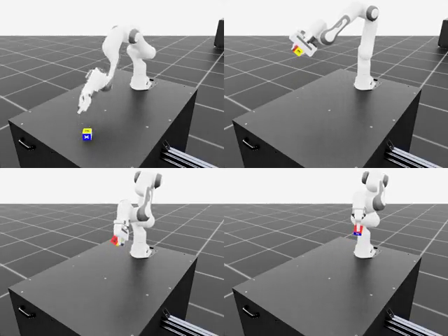
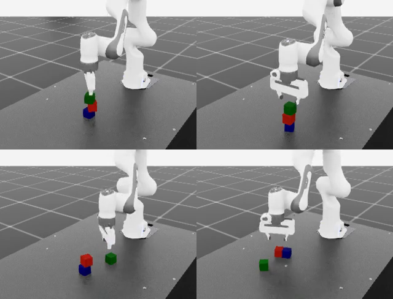
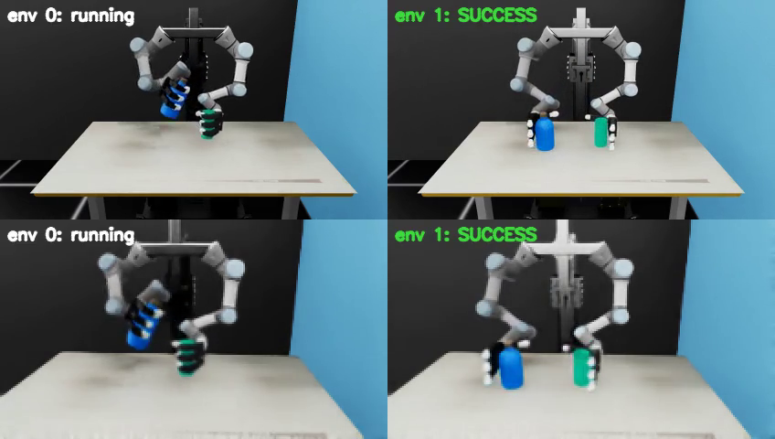
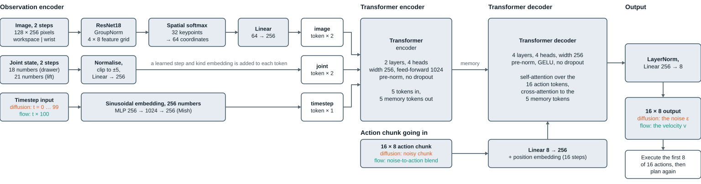

# Diffusion vs flow-matching policies on a Franka arm and a bimanual pour task (Isaac Lab)

A privileged teacher (RL/PPO or a scripted IK controller) generates demonstrations in simulation. A vision-based student
(camera images + joint states, no object state) learns from them. The student is one transformer denoiser
(ResNet18 + spatial-softmax encoder, 17.5 M parameters) trained either as a **diffusion policy** (noise target, DDIM
sampling) or as a **flow-matching policy** (velocity target, Euler sampling). Data, encoder, network, optimiser and
evaluation seeds are shared, so the comparison isolates the training objective and the sampler.
Four tasks: Franka cube lift, drawer opening, cube stacking (Isaac Lab Franka tasks) and a bimanual pour.
Isaac Sim 5.1 / Isaac Lab 2.3.2, one RTX 4070 (12 GB).

Project website: https://ismael-esp.github.io/franka-diffusion-flow-matching/

<table>
<tr>
<td></td>
<td></td>
<td></td>
</tr>
<tr>
<td align="center">lift (flow matching)</td><td align="center">stack (DAgger round 2)</td><td align="center">bimanual pour</td>
</tr>
</table>



*Posters are frames of the rollout videos; the diagram is the network both policies share.*

## Results

Success rate on held-out seeds, 200 episodes per seed. Standard error (SE) is about 1-2 points for the 600-800 episode rows and about 3.5 points
for the pour rows (200 episodes). All tables, per-seed values and further caveats: [report/RESULTS.md](report/RESULTS.md).

| Task | Diffusion (DDIM) | Flow matching (Euler) | Note |
|---|---|---|---|
| Stacking, demos only (10 steps, seeds 1001-1003) | 10.2 % | 7.3 % | both low; consistent with being limited by the data (not tested) |
| Stacking, demos only, like-for-like re-run (10 steps, seeds 1002-1005, idle GPU) | 10.9 % +- 1.1 | 9.3 % +- 1.0 | no meaningful difference |
| Stacking, DAgger round 2 (diffusion only, seeds 1002-1005) | 42.1 % +- 1.7 | not run | scripted teacher: 94.0 % |
| Drawer, scripted teacher (10 steps, seeds 1001-1003) | 92.2 % +- 1.1 | 92.3 % +- 1.1 | PPO-teacher student: 8.7 %; scripted teacher itself: 90.5 % |
| Lift, from scratch (10 steps, seeds 1001-1003) | 62.8 % +- 2.0 | 78.2 % +- 1.7 | flow matching with 1 Euler step: 66.0 % (seed 1001) |
| Pour, 5 steps (seed 201) | 27.5 % | 57.0 % | 50 steps: diffusion 51.5 %, flow matching 41.5 % |

Read these with the following caveats:

- Diffusion and flow rows come from **different training runs, one training seed each**. Differences of a few points are not meaningful. The lift (+15 points) and
  pour-at-5-steps (+29.5 points) gaps are well outside the standard errors but are still single training runs.
- **DDIM with 1 step is not comparable to flow with 1 step.** `ddim_timesteps(100, 1)` is `[0]`: the single network call is made at t = 0 on pure noise (alpha about 0.9994), so the
  output is about the initial noise. The measured 0 % for diffusion on lift is a property of that sampling grid; a trailing grid starting at t = 99 was not tested. Likewise the 5-step DDIM grid
  (80, 60, 40, 20, 0) never sees the noisiest levels, an untested possible contributor to diffusion's 27.5 % on pour at 5 steps.
- **Stacking DAgger:** round 2 was chosen on seed 1001; 42.1 % is computed on seeds 1002-1005 only. Round 3 got worse (23.1 %), and retraining from scratch on all DAgger data stayed near 2 %
  for both objectives (cause not verified). Flow matching was not run as a DAgger chain.
- **GPU contention gives wrong numbers**: a DAgger round-2 evaluation that ran beside a training job gave 6 % instead of 43.5 % on an idle GPU. Evaluate on an idle GPU. The simulator is also
  not bit-deterministic: per-seed numbers moved by up to about 0.5 points when `--num-envs` changed.
- The pour environment has no water particles: success is a task-stage criterion. The older chart numbers for pour (63.0 %, `report/export_build/data/summary_results.csv`) belong to a different model
  (`bc_x2_ft1200`, fine-tuned from `bc_lag400`, 40k steps), not to `bc_lag1200` (51.5 % on seed 201).
- Lift numbers are for from-scratch training on the same 1,900 zoom-camera demos. Earlier fine-tune-chain diffusion lift policies reached 72-76 % and are not comparable.

## Contents

1. [Requirements and install](#1-requirements-and-install)
2. [Tasks](#2-tasks)
3. [Collecting demonstrations](#3-collecting-demonstrations)
4. [Training](#4-training)
5. [Inference and evaluation](#5-inference-and-evaluation)
6. [Reproducing the pipelines](#6-reproducing-the-pipelines)
7. [Visualisations and plots](#7-visualisations-and-plots)
8. [Repository layout](#8-repository-layout)
9. [Troubleshooting](#9-troubleshooting)
10. [Citation, acknowledgements, license](#10-citation-acknowledgements-license)

Status labels used for commands: **Tested** = executed without the simulator in a clean copy of the repository; **Checked against the code only** = flags parsed with the script's own
argparse (or read from the source), but the script was not run because it needs Isaac Sim and a free GPU; **Not tested** = third-party instructions taken from the official guides.

## 1. Requirements and install

**Hardware used:** one NVIDIA GeForce RTX 4070 (12 GB), driver 580.178.04, Linux. Training reads images from disk (memory-mapped), so disk speed matters; simulation with cameras is the
VRAM-heavy part (see Troubleshooting). Disk: one 400-episode stack/drawer dataset is about 12 GB (`images.npy` is episodes x steps x 128 x 256 x 3 uint8); the lift set
(1,900 episodes of 250 steps) is about 47 GB. The whole project took about 170 GB.

**Software (conda env the results were produced in):**

| Component | Version |
|---|---|
| Python | 3.11.18 |
| Isaac Sim | 5.1.0.0 (pip wheels) |
| Isaac Lab | 2.3.2 (git tag `v2.3.2`, commit `37ddf6268`, editable install; `isaaclab` 0.54.2, `isaaclab_tasks` 0.11.12) |
| PyTorch | 2.7.0+cu128 (torchvision 0.22.0) |
| rsl-rl-lib | 3.1.2 (PPO teachers only) |
| numpy / gymnasium / imageio | 1.26.0 / 1.2.1 / 2.37.0 (+ imageio-ffmpeg 0.8.0) |

Install Isaac Sim and Isaac Lab by the official pip route for Isaac Lab 2.3.x
(https://isaac-sim.github.io/IsaacLab/main/source/setup/installation/pip_installation.html). Prerequisites from that guide: a recent Linux (GLIBC >= 2.35, i.e. Ubuntu 22.04 or newer),
an NVIDIA driver supporting CUDA 12.8 builds, and build tools (`sudo apt install build-essential cmake`). The commands follow the guide and match what the env's `pip list` shows.
**Not tested** (nothing was re-installed); adapt CUDA/driver and paths to your machine:

```bash
conda create -n isaaclab python=3.11 -y && conda activate isaaclab
pip install --upgrade pip
pip install "isaacsim[all,extscache]==5.1.0" --extra-index-url https://pypi.nvidia.com
pip install torch==2.7.0 torchvision==0.22.0 --index-url https://download.pytorch.org/whl/cu128
export OMNI_KIT_ACCEPT_EULA=YES                  # accept the Omniverse EULA non-interactively (otherwise you are asked on first launch)
git clone https://github.com/isaac-sim/IsaacLab.git && cd IsaacLab && git checkout v2.3.2
./isaaclab.sh --install                          # installs the isaaclab_* packages and ALL RL frameworks by default; `--install rsl_rl` for rsl_rl only
python scripts/tutorials/00_sim/create_empty.py  # the guide's own check: opens an empty simulation (add --headless on a server)
cd ..
git clone https://github.com/ismael-esp/franka-diffusion-flow-matching.git && cd franka-diffusion-flow-matching
pip install -r requirements.txt                  # only fills in what is missing (imageio, matplotlib, ...)
```

All commands below are run **from the repository root** with the `isaaclab` env active (`python` is that env's python; the run scripts also honour `ISAACLAB_PYTHON=/path/to/python`).
The first Isaac Sim start downloads/compiles extensions and takes several minutes.

Check the Python side (**Tested**), then a short simulation of the stock lift env (**Not tested**):

```bash
python -c "import torch, isaaclab; print(torch.__version__, torch.cuda.is_available())"   # isaaclab_tasks needs the launched app (pxr), so it is imported in the next snippet
python - <<'EOF'
from isaaclab.app import AppLauncher
app = AppLauncher(headless=True).app
import gymnasium as gym, isaaclab_tasks, torch
from isaaclab_tasks.manager_based.manipulation.lift.config.franka.joint_pos_env_cfg import FrankaCubeLiftEnvCfg
cfg = FrankaCubeLiftEnvCfg(); cfg.scene.num_envs = 4
env = gym.make("Isaac-Lift-Cube-Franka-v0", cfg=cfg); env.reset()
for _ in range(20): env.step(torch.zeros(4, 8, device=env.unwrapped.device))
print("isaac lab ok"); app.close()
EOF
```

**Pour task.** The pour task needs an external bimanual Isaac Lab environment (`TRLDistill_v5`), which is not part of this repository and not released. Its demonstration and teacher scripts
(`pouring_diffusion/collect_*.py`, `render_demos.py`, the pour recording scripts in `report/`) import it. The pour policy training and evaluation code is included and expects the environment under
`../TRLDistill_v5` or at the path in `TRLDISTILL_V5`. Franka lift, drawer and stack need only Isaac Lab.

**Not published:** demonstrations, checkpoints and run logs (`runs/`, `logs/`); the scripts regenerate them.

**Path configuration.** Scripts find the shared network code (`dp_core`) in `pouring_diffusion/` of this repository; set `DP_ROOT=/path/with/dp_core` to use another copy.
Other variables are listed in [report/SCRIPTS.md](report/SCRIPTS.md).

## 2. Tasks

All Franka tasks use the Isaac Lab registered env, made *distillable* (no last-action input for the teacher, randomised object poses) with a workspace camera and a wrist camera
(`fd_core/env.py` for lift, `fd_core/tasks.py` for drawer and stack). The student always gets the same interface: **image = [workspace | wrist], 128 x 128 each side by side (128 x 256), the last
2 frames; proprio = joint positions and velocities relative to the defaults** (18 numbers for drawer/stack; 21 for lift, where the goal position is appended). **Action = 8-D: 7 normalised absolute
joint targets in [-1, 1] and a binary gripper (+1 open, -1 close)**; the policy predicts 16 steps and executes the first 8 (receding horizon), then re-plans.

| Task | Isaac Lab env | Episode | Success (checked at the final step) | Teacher for the reported results |
|---|---|---|---|---|
| `lift` | `Isaac-Lift-Cube-Franka-v0` | 250 steps, 50 Hz | cube centre within 5 cm of the goal position | PPO (rsl_rl, 1,500 iterations) with privileged cube state; zoomed workspace camera (focal 25 mm) |
| `drawer` | `Isaac-Open-Drawer-Franka-v0` | 240 steps, 30 Hz | top drawer opened >= 0.30 m (travel 0.39 m); cabinet pose randomised at each reset | **scripted IK** (`fd_core/scripted.py: DrawerScript`); the PPO teacher is a negative result (student 8.7 %) |
| `stack` | `Isaac-Stack-Cube-Franka-v0` | 300 steps, 20 Hz | cube 2 on cube 1 and cube 3 on cube 2 (Isaac Lab `cubes_stacked` tolerances), gripper released | **scripted IK** (`StackScript`, `resync` mode for DAgger) |
| `pour` | external bimanual pour env (two UR3 arms with Allegro hands, cup and bottle) | 704 steps, 60 Hz | the env's pour-stage criterion (`subgoal >= 9`: poured, both objects placed and released, hands retreated); no water particles | privileged RL (MAT) policy of that environment |

Teachers and how their data differs:

- **RL / PPO** (lift, drawer): a privileged actor-critic sees the object state. Its actions are rough (mean step-to-step change about 25x that of the scripted drawer teacher), which a camera
  student cannot copy: for the drawer the student reached 8.7 % from the PPO teacher and 92.2 % from the scripted one.
- **Scripted IK with DART noise** (drawer, stack): a state machine (above, descend, close, lift/pull, release) with damped least-squares IK; targets are recomputed every step from the true object poses.
  **DART:** with `--noise-std s`, Gaussian noise of std `s` (normalised action units) is added to the *executed* arm command while the *clean* teacher action is recorded as the label, so the demos contain
  off-nominal states with the right correction.
- **DAgger with resync:** with `--student CKPT --beta 0` the student drives every env, the teacher labels each visited state, and *every* episode is kept. For stacking the scripted teacher is created with
  `resync=True`: its phase is re-derived from the scene each step, since the student's behaviour breaks the state machine's bookkeeping. The student is then fine-tuned on demos plus all rounds so far.
  `--beta` is the fraction of envs driven by the teacher.
- **Lift recovery demos** (`collect_demos.py --perturb`): failure states (empty close, knock, drop) are injected into teacher rollouts; only successful recoveries are kept.

## 3. Collecting demonstrations

Two collectors with the same dataset format (an existing output folder is refused; one batch = `--num-envs` parallel episodes, at most `--max-batches` batches, stop at `--target` kept episodes):

- `collect_demos.py`: lift, PPO teacher checkpoint. Flags `--wrist` (adds the eye-in-hand camera), `--zoom` (zoomed workspace camera), `--perturb` (recovery demos), `--robust-teacher`.
- `collect_task.py`: drawer and stack, `--teacher scripted` or an rsl_rl checkpoint. It **always** records workspace + wrist cameras and has no `--wrist`/`--zoom` flags.

**PPO teachers** (the lift teacher is needed for the lift demos). It is Isaac Lab's stock rsl_rl training script; the saved `agent.yaml` of our run shows seed 42, 1,500 iterations, 4,096 envs, experiment
`franka_lift`. The exact original command was not recorded; this one is inferred from those logs. **Not tested**:

```bash
cd /path/to/IsaacLab && ./isaaclab.sh -p scripts/reinforcement_learning/rsl_rl/train.py \
    --task Isaac-Lift-Cube-Franka-v0 --headless --seed 42 --max_iterations 1500
# -> IsaacLab/logs/rsl_rl/franka_lift/<timestamp>/model_1499.pt ; copy or symlink the run folder into <repo>/logs/rsl_rl/franka_lift/
```

Optional teachers (**Checked against the code only**): `python train_teacher_robust.py --iterations 2000` (robust lift teacher: no last-action observation, noise, cube pushes) and
`python train_teacher_task.py --task drawer` (the PPO drawer teacher behind the 8.7 % student).

**Demonstration sets behind the reported results.** Commands as in the run scripts; **Checked against the code only**:

```bash
T=logs/rsl_rl/franka_lift/<run>/model_1499.pt

# lift: 1,900 demos = 300 clean + 200 DART(0.05) + 300 clean + 500 DART(0.10) + 600 recovery   (run_resolution.sh)
python collect_demos.py --teacher $T --wrist --zoom --target 300 --seed 11 --output runs/zoom_clean
python collect_demos.py --teacher $T --wrist --zoom --target 200 --noise-std 0.05 --seed 12 --output runs/zoom_dart
python collect_demos.py --teacher $T --wrist --zoom --target 300 --seed 31 --output runs/zoom_clean2
python collect_demos.py --teacher $T --wrist --zoom --target 500 --noise-std 0.10 --seed 32 --max-batches 60 --output runs/zoom_dart10
python collect_demos.py --teacher $T --wrist --zoom --perturb --target 600 --num-envs 64 --max-batches 30 --seed 51 --output runs/zoom_recovery

# stack: 800 demos = 400 clean + 400 DART(0.01), scripted teacher
python collect_task.py --task stack  --teacher scripted --target 400 --num-envs 24 --seed 71 --output runs/stack/demos_clean
python collect_task.py --task stack  --teacher scripted --target 400 --num-envs 24 --noise-std 0.01 --seed 72 --output runs/stack/demos_dart01

# drawer: 800 demos = 400 clean + 400 DART(0.03), scripted teacher
python collect_task.py --task drawer --teacher scripted --target 400 --seed 71 --output runs/drawer_s/demos_clean
python collect_task.py --task drawer --teacher scripted --target 400 --noise-std 0.03 --seed 72 --output runs/drawer_s/demos_dart03
```

**DAgger** (stack: 400 episodes per round, student drives, scripted teacher with resync labels, then fine-tune; `run_stack_dagger.sh` does 3 rounds). **Checked against the code only**:

```bash
python collect_task.py --task stack --teacher scripted --student runs/stack/dp/bc_best.pt --beta 0.0 \
    --target 400 --num-envs 24 --seed 81 --output runs/stack/dagger1
```

**Pour** (needs the external environment; **Checked against the code only**). Demo sets used: 400 and 800 teacher episodes, `--noise-std 0.01`, stage `collect_lag`; seeds were not recorded:

```bash
cd pouring_diffusion
python collect_teacher_demos.py --target 400 --noise-std 0.01 --output runs/demos_lag400 --headless
python collect_teacher_demos.py --target 800 --noise-std 0.01 --output runs/demos_lag800b --headless
python train_bc.py --dataset runs/demos_lag400 --output runs/bc_lag400        # the policy that drives DAgger (a copy of its bc_best.pt was kept under models/ in our runs)
python collect_dagger.py --checkpoint runs/bc_lag400/bc_best.pt --mode dagger --beta 0.2 --output runs/dagger1 --headless
```

**Dataset format on disk** (`pouring_diffusion/dp_core/data.py` reads it; one folder per collection):

| File | Shape / dtype | Content |
|---|---|---|
| `images.npy` | `[E, T, 128, 256, 3]` uint8 | workspace camera \| wrist camera, side by side (memory-mapped during training) |
| `proprio.npy` | `[E, T, 1, 18]` float32 (21 for lift) | joint position and velocity relative to the defaults (lift: + goal position) |
| `action.npy` | `[E, T, 8]` float32 | teacher's clean normalised absolute command (7 joints + gripper) |
| `share.npy` | `[E, T, 1, 1]` | unused (zeros) |
| `kept.npy` | `[E]` bool | which episodes are valid (all of them for DAgger) |
| `meta.json` | | task, teacher, kept/tried, `noise_std`, `student`, `beta`, `seed`, `wrist`, `zoom` |
| `cube.npy` | `[E, T, 3]` | lift only (`collect_demos.py`): privileged cube position, an auxiliary target for the v3 student |

`T` = 250 (lift), 240 (drawer), 300 (stack). Evaluating a lift checkpoint with `eval_policy.py` re-reads the `meta.json` of the dataset folders listed in the checkpoint (for `wrist`/`zoom`, via
`fd_core.policy.camera_setup`): keep those folders (at least `meta.json`) at the same relative paths. A dataset of your own in this format works with `train_dp.py` unchanged.

## 4. Training

`train_dp.py` trains the student on one or more dataset folders. `--objective diffusion` or `--objective flow`; everything else is shared. Output folders must not exist.

```bash
# stack (diffusion baseline, flow matching)    -- Checked against the code only; a 20-step version ran on synthetic data (Tested)
python train_dp.py --objective diffusion --dataset runs/stack/demos_clean runs/stack/demos_dart01 --steps 30000 --bf16 --output runs/stack/dp
python train_dp.py --objective flow      --dataset runs/stack/demos_clean runs/stack/demos_dart01 --steps 30000 --bf16 --output runs/flow/fm_stack
# drawer
python train_dp.py --objective diffusion --dataset runs/drawer_s/demos_clean runs/drawer_s/demos_dart03 --steps 30000 --bf16 --output runs/drawer_s/dp
python train_dp.py --objective flow      --dataset runs/drawer_s/demos_clean runs/drawer_s/demos_dart03 --steps 30000 --bf16 --output runs/flow/fm_drawer
# lift: both objectives from scratch on the five zoom datasets (run_flow.sh)
Z="runs/zoom_clean runs/zoom_dart runs/zoom_clean2 runs/zoom_dart10 runs/zoom_recovery"
python train_dp.py --objective diffusion --dataset $Z --steps 30000 --bf16 --output runs/flow/dp_lift
python train_dp.py --objective flow      --dataset $Z --steps 30000 --bf16 --output runs/flow/fm_lift
# DAgger fine-tune: continue from the previous model on demos + all DAgger rounds so far
python train_dp.py --dataset runs/stack/demos_clean runs/stack/demos_dart01 runs/stack/dagger1 \
    --init runs/stack/dp/bc_best.pt --steps 15000 --warmup-steps 200 --output runs/stack/dp_dagger1 --bf16
python train_dp.py --smoke --dataset runs/stack/demos_clean --output runs/smoke      # 6-step pipeline check
```

**`--init` and the objective:** `--init` loads the weights and the config, and `--objective` now defaults to the checkpoint's objective; passing a different one is an error. Without this check, fine-tuning a flow checkpoint and omitting `--objective flow` would silently train the diffusion loss. `--ddim-steps` stored at training time is the
default sampling-step count of the checkpoint (10); for a flow checkpoint it is the number of Euler steps. The same flag name sets the count at evaluation (`eval_policy.py --ddim-steps`, `eval_task.py --inference-steps`).

Key settings (defaults of `train_dp.py` unless noted; architecture in `pouring_diffusion/dp_core/model.py` and `flow.py`):

| Item | Value |
|---|---|
| Observation | 2 past steps of (image, proprio); 4 observation tokens + 1 timestep token |
| Encoder | ResNet18 with GroupNorm, spatial softmax (32 keypoints) on a 4 x 8 feature grid, Linear to 256 |
| Denoiser | transformer, encoder 2 / decoder 4 layers, 4 heads, width 256, feed-forward 1024, pre-norm, no dropout; 17.5 M parameters |
| Chunk | predict 16 steps x 8 values, execute 8 (`--pred-horizon`, `--exec-horizon`) |
| Diffusion | 100 train timesteps, cosine schedule, noise prediction, DDIM (eta 0), 10 sampling steps by default |
| Flow matching | `x_t = (1-t) noise + t action`, `t ~ U(0,1)`, velocity target `action - noise`, Euler with k steps |
| Optimiser | AdamW, lr 1e-4, weight decay 1e-4, 500 warm-up steps then cosine decay, grad clip 1.0 |
| Batch / precision | batch 128 (`--accum N` splits it into N micro-batches for less VRAM), bf16 autocast with `--bf16` |
| EMA | 0.999; the EMA weights are validated and saved |
| Steps | 30,000 from scratch; 15,000 per DAgger fine-tune round; pour 80,000 |
| Validation | 10 % of episodes held out; every 2,000 steps the sampled-action MSE is computed; `bc_best.pt` = lowest validation action MSE (never chosen by simulator success) |

Output folder: `bc_best.pt`, `bc_final.pt` (config, EMA weights, normalisers, step, dataset list, args, `objective`), `metrics.jsonl` (train loss, val loss, val action MSE), `command.json`.

**Time on the RTX 4070:** about 5-6 steps/s at batch 128 with bf16 in our logs (some runs shared the GPU), i.e. about 1.5 h per 30,000 steps (the flow stacking run: 1 h 38 min); pour runs
(80k steps) ran at 7.4 steps/s, about 3 h. Peak training VRAM was not measured.

**Pour training** (external environment needed only for the data; **Checked against the code only**). `train_bc.py` has no `--accum`; its defaults are pred 32 / exec 16 and 60,000 steps:

```bash
cd pouring_diffusion
python train_bc.py --dataset runs/demos_lag400 runs/demos_lag800b --steps 80000 --bf16 --output runs/bc_lag1200
python train_fm.py --dataset runs/demos_lag400 runs/demos_lag800b --steps 80000 --bf16 --output runs/fm_lag1200
```

## 5. Inference and evaluation

Evaluation runs the student closed loop in the simulator on a fixed seed (`--seed` sets the scene randomisation; held-out seeds 1001-1005 for Franka, 201 for pour; seed 1001 was also used for model
selection in the stack DAgger study). **Checked against the code only**:

```bash
# drawer / stack: eval_task.py. --inference-steps overrides the number of DDIM / Euler steps (0 = checkpoint's default)
python eval_task.py --task stack --checkpoint runs/flow/fm_stack/bc_best.pt --episodes 200 --num-envs 50 \
    --seed 1001 --inference-steps 5 --output runs/flow/test_fm_stack_k5_s1001.json
python eval_task.py --task drawer --teacher scripted --num-envs 6 --seed 31 --video-dir runs/drawer/videos_teacher --output runs/drawer/vid_teacher.json
python eval_task.py --task stack --checkpoint runs/stack/dp_dagger2/bc_best.pt --num-envs 8 --seed 32 --video-dir runs/stack/videos --output runs/stack/vid.json

# lift: eval_policy.py (the flag is --ddim-steps here; it is also the Euler step count of a flow checkpoint)
python eval_policy.py --checkpoint runs/flow/fm_lift/bc_best.pt --episodes 200 --seed 1001 --ddim-steps 10 --output runs/flow/test_fm_lift_k10_s1001.json
python eval_policy.py --checkpoint runs/flow/fm_lift/bc_best.pt --episodes 8 --num-envs 8 --video 8 --seed 7 --output runs/video_lift.json
python eval_policy.py --teacher $T --episodes 200 --output runs/eval_teacher.json            # the PPO teacher itself

# pour (needs the external environment): --ddim-steps is also the Euler step count for eval_fm.py
cd pouring_diffusion
python eval_policy.py --snap-grip --num-envs 32 --episodes 200 --headless --seed 201 --checkpoint runs/bc_lag1200/bc_best.pt --ddim-steps 50 --output runs/sweep/lag1200_ddim50.json
python eval_fm.py     --snap-grip --num-envs 32 --episodes 200 --headless --seed 201 --checkpoint runs/fm_lag1200/bc_best.pt --ddim-steps 5  --output runs/sweep/fm_lag1200_k5.json
python record_video.py --checkpoint runs/fm_lag1200/bc_best.pt --snap-grip --output runs/videos/fm.mp4 --stage eval --num-envs 6 --headless
```

Behaviour you need to know:

- **Receding horizon:** the policy samples a 16-step chunk (pour: 32), executes the first 8 (pour: 16) actions, then re-samples from the newest 2 frames. The gripper command is snapped to +-1. One sample per call, no ensembling.
- **Sampling steps:** DDIM with `k` steps for diffusion (default 10), `k` Euler steps for flow. A one-step DDIM run only evaluates t = 0 and is not comparable to one-step flow (see Results).
- **Output files.** `eval_task.py` writes `{task, checkpoint, teacher, seed, episodes, inference_steps, success, se, outcomes, mean_progress}` and **silently overwrites** an existing output file. `eval_policy.py`
  (lift) writes `{success_rate, successes, se, ci95 (Wilson), mean_final_dist, ...}` and refuses to overwrite.
- **`--episodes` vs `--num-envs`.** `eval_task.py` runs `episodes // num_envs` batches (at least one) and counts all episodes of every batch, so `--episodes 8 --num-envs 50` evaluates 50 episodes and
  `--episodes 200 --num-envs 48` evaluates 192; with `--video-dir` it always runs exactly one batch. `eval_policy.py` stops at exactly `--episodes`.
- **Videos.** `eval_task.py --video-dir DIR` writes one 480 x 360 mp4 per env into `DIR`, named with the outcome (`<task>_s<seed>_e<i>_<outcome>.mp4`). `eval_policy.py --video N` writes one grid mp4 of the first N envs of the
  first batch next to the JSON (same name, `.mp4`). Use few envs: every env with video gets an extra camera.
- Evaluate on an **idle GPU** with the `--num-envs` you intend to compare (see Troubleshooting).

## 6. Reproducing the pipelines

`scripts/run_repro_minimal.sh` is the shortest sequence that works from a clean clone (bash syntax-checked, **not executed end to end**). It collects the stack, drawer and lift demos, trains
the diffusion baselines, runs the stack DAgger rounds, then `run_flow.sh` (flow matching vs diffusion on stack, drawer, lift, sampling-step sweep, and pour if the external environment is available) and `run_improve.sh`:

```bash
TEACHER=logs/rsl_rl/franka_lift/<run>/model_1499.pt bash scripts/run_repro_minimal.sh
```

Order and dependencies, in short: scripted stack/drawer demos -> baselines (`runs/stack/dp`, `runs/drawer_s/dp`) -> `run_stack_dagger.sh` (needs `runs/stack/dp`) -> lift zoom demos (needs the PPO teacher) ->
`run_flow.sh` (needs the demos above; the pour part needs the external environment) -> `run_improve.sh` (needs the outputs of all previous scripts). Expect several GPU days. The original `run_*.sh`
scripts (older lift experiments, the PPO-teacher drawer, scripts that chain from earlier checkpoints, scripts not used for the reported numbers) and what each depends on are listed in
[report/SCRIPTS.md](report/SCRIPTS.md). `run_final.sh` needs `RT=<robust-teacher checkpoint>`.

## 7. Visualisations and plots

### Without Isaac Sim (from the committed data in `report/data/`)

```bash
bash scripts/make_all_plots.sh                        # report/make_plots.py + report/tools/make_diagrams.py; PYTHON=/path/to/python to choose the interpreter
FD_PLOTS_OUT=/tmp/plots python report/make_plots.py   # write plots/ and data/ somewhere else instead of in place
python scripts/check_readme.py                        # README paths, flags and wording rules
```

**Tested** from a clean copy of the repository (no `runs/`, no `DP_ROOT`): the CSV tables of `report/export_build/data` and the diagram SVGs plus `report/page4.html` (`report/diagrams/`)
reproduce byte for byte (the plot SVGs differ only by the date in their metadata); plot PNGs are regenerated and may differ at pixel level. `make_diagrams.py` uses the demo chunk saved in
`report/data/arch_chunk.json` when `runs/drawer_s/demos_clean` is absent. Needs numpy, matplotlib and (diagram script) torch for the `dp_core` import.

The report pages `report/index.html`, `page2.html`, `page3.html`, `page4.html` open in a browser (keep `media/`, `shared.css`, `shared.js` next to them).

### What needs the simulator or recorded runs

Attention / saliency (`record_attention.py`, `attention_task.py`, `make_attention_stills.py`), the denoising and flow-integration overlays (`record_denoise.py`, `report/record_task.py`,
`report/sim_chunks.py`, `report/sim_task.py`), the pour recordings (`report/pour_*.py`), the video-data scripts (`report/make_*_data*.py`), recovery tests (`record_recovery.py`, `diagnose.py`), and
the Remotion results video (`report/video/`) need Isaac Sim and/or recorded runs and checkpoints that are not in this repository. All of them are **Checked against the code only**; their
arguments, inputs and outputs are listed in [report/SCRIPTS.md](report/SCRIPTS.md).

## 8. Repository layout

| Path | Contents |
|---|---|
| `collect_demos.py`, `collect_task.py` | demonstrations: lift (PPO) / drawer, stack (scripted or PPO); DART noise; DAgger |
| `train_dp.py` | student training, `--objective {diffusion,flow}` |
| `eval_task.py`, `eval_policy.py` | closed-loop evaluation and videos (drawer, stack / lift) |
| `train_teacher_task.py`, `train_teacher_robust.py` | PPO teachers (drawer; robust lift) |
| `fd_core/` | `env.py` (lift env, cameras), `tasks.py` (drawer, stack), `scripted.py` (scripted teachers), `rollout.py` (actors, DAgger, perturbations), `policy.py` (checkpoint loading), `model_v3.py` |
| `pouring_diffusion/` | `dp_core/` (shared network, data, flow matching, pour env adapter), pour train/eval/collect scripts (the collect scripts need the external environment) |
| `record_*.py`, `attention_task.py`, `render_attention.py`, `make_attention_stills.py`, `preview_task.py`, `diagnose.py`, `debug_*.py` | recording, visualisation, debugging |
| `run_*.sh`, `scripts/` | pipelines that produced the results; `scripts/run_repro_minimal.sh`, `make_all_plots.sh`, `check_readme.py` |
| `report/` | pages, `RESULTS.md`, `DESIGN.md`, `SCRIPTS.md`, `data/` (small committed result data), plot/diagram/video-data scripts, `media/`, `diagrams/`, `export_build/`, `video/` (Remotion) |
| `requirements.txt`, `LICENSE`, `THIRD_PARTY_NOTICES.md` | packages besides Isaac Sim / Isaac Lab (versions we ran), licence, third-party notices |
| `runs/`, `logs/` | not in the repository: created by the scripts (checkpoints, demos, logs, results; about 170 GB) |

## 9. Troubleshooting

- **CUDA / Vulkan out of memory next to a training job.** Camera rendering for 50 envs plus a training process does not fit in 12 GB. Errors seen in our logs: `torch.OutOfMemoryError: CUDA out of memory`
  and, at simulator start, `carb.graphics-vulkan ... ERROR_OUT_OF_DEVICE_MEMORY` / `Failed to initialize Spatial Hash Grid Resources. This is likely because the GPU is out of memory`. Run one GPU job at a
  time, lower `--num-envs` (collection 24-48; evaluation used 50 on an idle GPU), or use `train_dp.py --accum 2` / a smaller `--batch-size`. See what holds memory with
  `nvidia-smi --query-compute-apps=pid,used_memory --format=csv`.
- **Eval numbers are suspiciously low or differ between runs.** GPU contention can corrupt an evaluation silently (a stacking model gave 6 % instead of 43.5 % beside a training job). Re-run on an idle GPU; do
  not compare numbers measured with different `--num-envs` to better than about 0.5 points.
- **Blotchy or ghosted camera frames.** Rendering is not bit-deterministic. The env sets FXAA (no temporal AA) and `rerender_on_reset`; `FD_RENDER=v2` disables the AI denoiser and sampled lighting (experimental, not used for reported numbers).
- **Headless / display errors.** All scripts force `headless = True` and `enable_cameras = True` (they need the RTX renderer, not a display). Use a machine with an NVIDIA driver and Vulkan support (`vulkaninfo | head`).
- **`FileNotFoundError: training datasets of ... not found`** when evaluating a lift checkpoint: `eval_policy.py` reads `wrist`/`zoom` from the `meta.json` of the datasets named in the checkpoint (relative to the repository root); keep them there.
- **`ModuleNotFoundError: dp_core` / `mat`.** `dp_core` is expected in `pouring_diffusion/` (or `DP_ROOT`); `mat` (pour teacher) comes with the external pour environment (`TRLDISTILL_V5`).
- **"... already exists; choose a new --output".** Collectors and trainers refuse to overwrite; the `run_*.sh` scripts skip finished steps. Delete the folder to redo a step. (`eval_task.py` is the exception: it overwrites.)

## 10. Citation, acknowledgements, license

If you use this code, please cite the repository (https://github.com/ismael-esp/franka-diffusion-flow-matching) and the original Diffusion Policy and flow-matching papers:

- C. Chi, S. Feng, Y. Du, Z. Xu, E. Cousineau, B. Burchfiel, S. Song, "Diffusion Policy: Visuomotor Policy Learning via Action Diffusion", RSS 2023 (arXiv:2303.04137).
- Y. Lipman, R. T. Q. Chen, H. Ben-Hamu, M. Nickel, M. Le, "Flow Matching for Generative Modeling", ICLR 2023 (arXiv:2210.02747).
- X. Liu, C. Gong, Q. Liu, "Flow Straight and Fast: Learning to Generate and Transfer Data with Rectified Flow", ICLR 2023 (arXiv:2209.03003).
- J. Song, C. Meng, S. Ermon, "Denoising Diffusion Implicit Models" (DDIM), ICLR 2021 (arXiv:2010.02502).
- S. Ross, G. Gordon, D. Bagnell, "A Reduction of Imitation Learning and Structured Prediction to No-Regret Online Learning" (DAgger), AISTATS 2011 (arXiv:1011.0686).
- M. Laskey, J. Lee, R. Fox, A. Dragan, K. Goldberg, "DART: Noise Injection for Robust Imitation Learning", CoRL 2017 (arXiv:1703.09327).
- Pour experiments also use ideas from A. Wagenmaker et al., "Steering Your Diffusion Policy with Latent Space Reinforcement Learning" (DSRL, 2025) and A. Z. Ren et al., "Diffusion Policy Policy Optimization" (DPPO).

Acknowledgements: NVIDIA Isaac Lab / Isaac Sim (simulation, Franka lift / drawer / stack tasks, rsl_rl PPO): https://github.com/isaac-sim/IsaacLab.

Code: MIT (see [LICENSE](LICENSE)). Isaac Sim/Lab and robot assets are under their own licences (see [THIRD_PARTY_NOTICES.md](THIRD_PARTY_NOTICES.md)).
